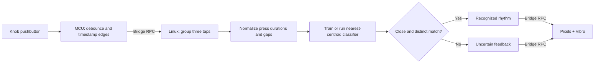

# QC UNO Q Workshop 203: Rhythm Key

As part of this workshop, attendees will turn the `101-Haptic Dial` hardware into a personal edge-AI interface that learns tapping rhythms using the knob's pushbutton.

The app interacts in the following manner:

- The MCU timestamps button presses and releases and drives the Pixels and Vibro Modulinos.
- The Linux MPU turns three taps into relative press durations and gaps.
- Attendees record examples of three rhythms and train a small classifier locally.
- The trained model recognizes new rhythms and rejects ambiguous or unfamiliar patterns.

All training and inference are local and do not depend on internet connectivity! Turning the knob is not part of this workshop.

> [!IMPORTANT]
> This is a `20x`-level workshop. Attendees should already be comfortable running an App Lab project and understand the MCU, MPU, and Bridge roles introduced in `101`.
>
> Complete the software prerequisites before arriving. Downloading App Lab or board software during the session will cause delays and may prevent you from keeping up with the build.

## Session Prerequisites

1. Complete or review [`101: Haptic Dial`](../101-haptic-dial/).
2. Install [Arduino App Lab](https://www.arduino.cc/en/software/#app-lab-section).
3. Clone this repository using `git clone https://github.com/aaishikasb/uno-q-workshops.git` in your terminal.

The collection and training flow will be familiar if you have completed [`201: Gesture Dial`](../201-gesture-dial/), but it is not required.

## Hardware Setup (Provided On-site)

### Required Hardware

- Arduino UNO Q
- Modulino Knob
- Modulino Pixels
- Modulino Vibro
- 3 Qwiic cables
- USB-C cable

### Wiring

Chain the Modulinos with Qwiic:

```text
UNO Q Qwiic -> Modulino Knob -> Modulino Pixels -> Modulino Vibro
```

The order is not important for I2C, but using the same order makes debugging easier.

After connecting all Modulinos, connect the UNO Q to your computer with USB-C. Release the knob button before starting the app.

## App Lab Setup

1. Open Arduino App Lab.
2. Select your UNO Q board.
3. If the `Updates` modal appears, **DO NOT** update the board firmware during the workshop.
4. Open **My Apps**.
5. Import `workshop-app.zip` from this directory.
6. Open the imported `UNO Q Rhythm Key` app.
7. Confirm these files are present:
   - `app.yaml`
   - `python/main.py`
   - `python/button.py`
   - `python/rhythm_model.py`
   - `sketch/sketch.ino`
   - `sketch/sketch.yaml`
8. Click `Run` in the top-right corner.
9. Keep the App Lab output panel visible. It tells you which rhythm to record and whether an example was accepted.

App Lab compiles and flashes the MCU sketch, then starts the Python runtime on the UNO Q Linux side. The Vibro pulses once during startup. No additional Python packages or model downloads are required beyond the App Lab runtime.

## Train Your Rhythm Key

The first run collects five examples of each rhythm in this order:

1. `spark`: short, short, long.
2. `wave`: long, short, short.
3. `drum`: short, long, short.

For a starting point, make short presses about 0.15 seconds, long presses about 0.6 seconds, and the gaps about 0.2 seconds. These are suggestions for collecting distinct examples, not hard-coded class rules. You can teach different three-tap patterns under the same labels.

For every example:

1. Check the App Lab output for the requested label.
2. Perform exactly three presses and releases. The first press starts the recording and is part of the rhythm; there is no separate start click.
3. Leave the button released for at least one second after the third tap.
4. Wait for the confirmation pulse and the next training prompt before recording again.

Each press must last 0.08–1.2 seconds. Gaps within the rhythm must last at least 0.08 seconds and less than one second. A one-second gap ends the recording after pending button transitions finish debouncing. Recordings have an eight-second limit. Two taps, extra taps, overlapping timestamps, or timings outside these limits are rejected without advancing training.

Training colors show the current label and progress:

| Color | Meaning |
| --- | --- |
| Pink | Record `spark` examples |
| Green | Record `wave` examples |
| Purple | Record `drum` examples or finish training |
| White | Recording is active |
| Amber | Retry the example or prediction was uncertain |
| Red | Saved model could not be erased; check the output |
| Blue | The trained recognizer is ready |

The number of colored Pixels during training shows collection progress. At least one stays lit while waiting; the output gives the exact example count and label. Feedback lasts about one second before the next ready prompt. A press begun before that prompt is ignored, even if released after it appears.

## Use The Trained Rhythm Key

After the fifteenth example, the Linux application trains and saves the model. When the Pixels turn blue, tap any trained rhythm without a separate start click.

- Pink indicates `spark`, green indicates `wave`, and purple indicates `drum`.
- Amber means the closest class was too far away or too similar to the next-best class.
- More lit Pixels indicate greater separation between the best and second-best matches.
- An accepted prediction produces a 220 ms pulse; an uncertain prediction produces an 80 ms pulse.

Watch the App Lab output for the label, separation score, and distance to each learned rhythm. Separation is a relative distance score, not a calibrated probability.

Hold the knob down for three seconds at any time to erase the saved model and repeat training. Release it before recording the first new rhythm. The reset hold is not a training example; it takes priority over any other taps delivered in the same batch.

## How The Demo Works



### MCU Responsibilities

- Sample the pushbutton at a target interval of 5 ms and debounce changes for 20 ms.
- Timestamp each accepted edge at the start of its stable transition.
- Buffer up to 32 edges so ordinary Bridge delays do not lose short taps.
- Report a buffer overflow instead of silently returning incomplete input.
- Report input time only through fully debounced samples, so a pending tap cannot be mistaken for the end of a rhythm or a reset hold.
- Render feedback and expose hardware services through safe Bridge callbacks.

### Linux MPU Responsibilities

- Poll queued button events with a 20 ms delay between iterations.
- Use MCU timestamps, including clock rollover, to measure taps and gaps.
- Collect five examples per label, train the model, and classify new rhythms.
- Discard interrupted or invalid captures and keep resets out of the training set.
- Save the model to `data/rhythm_model.json` using an atomic file replacement.

## The Model

This workshop uses a nearest-centroid classifier implemented with the Python standard library. Three taps produce five features: three press durations and two gaps. Each value is divided by the total rhythm duration, so a uniformly faster or slower performance has the same representation while remaining within the capture limits.

Training calculates a mean feature vector for each label and a radius from its examples, with a minimum radius of `0.035`. Inference calculates the root-mean-square distance to each centroid. A prediction must be within twice its class radius and have a separation score of at least `0.20`:

```text
separation = (second-best distance - best distance) / max(second-best distance, 0.000000001)
```

The complete learning loop is:

```text
collect -> label -> normalize -> train -> recognize -> test -> retrain
```

All classes use three taps: the model learns their timing patterns, rather than identifying them by tap count. Similar patterns can overlap and should be rejected. This is a recognition exercise, not an authentication system.

## Suggested Experiments

- Train consistent patterns, then compare predictions when tapping uniformly faster or slower.
- Change just one gap instead of changing the entire tempo.
- Swap with a partner and count accepted, incorrect, and uncertain results on ten fresh attempts.
- Teach two labels the same pattern and observe uncertain predictions.
- Add varied examples during retraining and compare which previously rejected attempts are accepted.
- Change `MINIMUM_MARGIN` in `rhythm_model.py` and compare ambiguity against rejection.

## Troubleshooting

### The app keeps rejecting training examples

- Use exactly three taps. Do not add a separate start click.
- Keep each press between 0.08 and 1.2 seconds and each internal gap between 0.08 and less than one second.
- Wait for the next ready prompt before starting again. Read the output for the rejected timing or tap count.

### Different rhythms are confused or uncertain

- Use distinct press and gap patterns. Uniformly changing tempo does not create a different class.
- Hold for three seconds and retrain with consistent examples before introducing more variation.

### The app skips training when restarted

The model is intentionally persistent. Hold for three seconds to erase it. If saving fails, the app reports the error and continues with its in-memory model; a restart may load an older model or require training again.

### The output reports a button buffer overflow

Release the button, wait for the ready prompt, and retry. The incomplete rhythm is discarded. Repeated overflows or malformed button packets require restarting the app and checking board communication.

## Files

- `workshop-app/`: App Lab project source
- `workshop-app/python/main.py`: training, capture, and prediction flow
- `workshop-app/python/button.py`: MCU event parsing and reset-hold detection
- `workshop-app/python/rhythm_model.py`: timing features, classifier, and persistence
- `workshop-app/sketch/sketch.ino`: button timestamps and hardware feedback
- `workshop-app.zip`: importable App Lab project
- `test_rhythm_key.py`: regression check with simulated button events and Bridge calls
- `test_sketch.py`: host simulation of the actual sketch with stubbed Arduino hardware

Run from the repository root:

```sh
python3 -B 203-rhythm-key/test_rhythm_key.py
```

Software checks passed on 2026-10-30: model validation and persistence, training/live/reset flows, delayed input, debounce boundaries, and MCU clock rollover. The command above also runs the host sketch simulation when a C++17 compiler (`c++`) is available; otherwise it reports that portion as skipped. It creates and removes its temporary build files automatically.

App Lab import, board compilation, I2C communication, and physical timing still need an on-device check. The host simulation does not compile against the Arduino board libraries.

## Sources

- Arduino UNO Q hardware docs: https://docs.arduino.cc/hardware/uno-q
- Arduino App Lab docs: https://docs.arduino.cc/software/app-lab/
- Arduino Bridge guide: https://docs.arduino.cc/software/app-lab/bridge/get-started-with-bridge
- Arduino Bridge API: https://docs.arduino.cc/software/app-lab/bridge/bridge-api
- Arduino RouterBridge library: https://github.com/arduino-libraries/Arduino_RouterBridge
- Arduino App structure: https://docs.arduino.cc/software/app-lab/apps/about-apps
- Arduino Modulino library: https://docs.arduino.cc/libraries/arduino_modulino
- Pinned Modulino 0.8.0 API source: https://github.com/arduino-libraries/Arduino_Modulino/blob/0.8.0/src/Modulino.h
