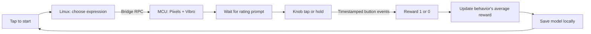

# QC UNO Q Workshop 204: Pocket Pet

As part of this workshop, attendees will turn the `101-Haptic Dial` hardware into a small light-and-vibration pet that learns which behaviors they prefer.

The app interacts in the following manner:

- The MCU reads the knob's pushbutton and drives the Pixels and Vibro Modulinos.
- The Linux MPU selects one of three expressions using a small reward-learning model.
- Attendees reward or reject expressions through short taps and longer holds.
- The pet learns from those ratings while continuing to explore other behaviors.

All learning and action selection are local and do not depend on internet connectivity! Turning the knob is not part of this workshop.

> [!IMPORTANT]
> This is a `20x`-level workshop. Attendees should already be comfortable running an App Lab project and understand the MCU, MPU, and Bridge roles introduced in `101`.
>
> Complete the software prerequisites before arriving. Downloading App Lab or board software during the session will cause delays and may prevent you from keeping up with the build.

## Session Prerequisites

1. Complete or review [`101: Haptic Dial`](../101-haptic-dial/).
2. Install [Arduino App Lab](https://www.arduino.cc/en/software/#app-lab-section).
3. Clone this repository using `git clone https://github.com/aaishikasb/uno-q-workshops.git` in your terminal.

You do not need to complete another `20x` workshop first. Unlike [`201: Gesture Dial`](../201-gesture-dial/), this app learns from rewards during interaction rather than collecting a labeled dataset before use.

## Hardware Setup (Provided On-site)

### Required Hardware

- Arduino UNO Q
- Modulino Knob
- Modulino Pixels
- Modulino Vibro
- 3 Qwiic cables
- USB-C cable

### Wiring

Chain the Modulinos with Qwiic:

```text
UNO Q Qwiic -> Modulino Knob -> Modulino Pixels -> Modulino Vibro
```

The order is not important for I2C, but using the same order makes debugging easier.

After connecting all Modulinos, connect the UNO Q to your computer with USB-C. Place the Vibro where you can feel its expressions and release the knob button before starting the app.

## App Lab Setup

1. Open Arduino App Lab.
2. Select your UNO Q board.
3. If the `Updates` modal appears, **DO NOT** update the board firmware during the workshop.
4. Open **My Apps**.
5. Import `workshop-app.zip` from this directory.
6. Open the imported `UNO Q Pocket Pet` app.
7. Confirm these files are present:
   - `app.yaml`
   - `python/main.py`
   - `python/button.py`
   - `python/pet_model.py`
   - `sketch/sketch.ino`
   - `sketch/sketch.yaml`
8. Click `Run` in the top-right corner.
9. Keep the App Lab output panel visible. It names each expression, explains why it was selected, and shows the learned reward values.

App Lab compiles and flashes the MCU sketch, then starts the Python runtime on the UNO Q Linux side. The Vibro pulses once during startup. No additional Python packages or model downloads are required beyond the App Lab runtime.

## Train Your Pet

The pet has three expressions:

| Expression | Pixels | Vibro |
| --- | --- | --- |
| `glow` | Pink, growing from three to six to eight lit Pixels | One short 80 ms pulse |
| `bounce` | Green, growing from two to five to eight lit Pixels | Three short 90 ms pulses |
| `purr` | Eight purple Pixels | One longer 500 ms pulse |

For every round:

1. When the Pixels are blue, tap and release the knob to request an expression. A start tap lasts 0.08–0.6 seconds.
2. Watch and feel the expression. Wait for **two white Pixels** and the `RATE NOW` message before responding.
3. Reward it with a short 0.08–0.6 second tap, or reject it by holding the button for 1–2.5 seconds and releasing.
4. Read the updated reward values in the output. The Pixels return to blue.
5. Tap again to request the next expression.

The start tap is not a reward. Input during an expression is ignored for rating purposes; release the button and wait for the white rating prompt. A rating press must begin after that prompt, even if earlier button events arrive late over Bridge. Holds between 0.6 and 1 second, or between 2.5 and 3 seconds, ask you to retry the rating without updating the model. Holds of three seconds reset the pet.

Expressions normally take about one second. If a Bridge call is delayed, playback takes longer so the separate pulses remain distinct. The rating prompt appears after playback finishes and the button is released.

The pet tries each behavior until it has received a rating for all three. After that, it usually chooses a behavior with the highest average reward and sometimes explores. Choose one favorite, consistently reward it, and reject the other two for about 20 rounds. The number of rounds needed to see a preference varies because exploration is random.

| Color or pattern | Meaning |
| --- | --- |
| Eight blue Pixels | Ready for a tap to start the next round |
| Growing pink Pixels | `glow` expression |
| Growing green Pixels | `bounce` expression |
| Eight purple Pixels | `purr` expression |
| Two white Pixels | Waiting for your rating |
| Three amber Pixels | Input was lost; release and tap to start a fresh round |
| Eight red Pixels | Saved learning could not be erased; check the output |

## Use The Trained Pet

There is no separate live mode: the pet updates its model after every valid rating and saves it immediately. Restarting the app loads those learned preferences.

The output shows:

- The selected behavior and whether it was a first example, exploration, or exploitation.
- Whether your response rewarded or rejected it.
- Each behavior's average reward and number of ratings.

An average reward of `0.75` means that three quarters of that behavior's recorded ratings were positive. It is not the probability that the pet will choose that behavior next.

Hold the knob down for three seconds at any time to erase the saved learning. Release it, then tap to meet the new pet. The reset hold never counts as a rejection and takes priority over any other taps delivered in the same batch.

## How The Demo Works



### MCU Responsibilities

- Sample the pushbutton at a target interval of 5 ms and debounce changes for 20 ms.
- Timestamp and buffer up to 32 button edges; report overflow so incomplete ratings are discarded.
- Allow pending release transitions to finish debouncing before deciding that a hold reached three seconds.
- Drive light and vibration commands through safe Bridge callbacks.

### Linux MPU Responsibilities

- Select and play an expression, then open a separate rating stage.
- Use MCU timestamps to distinguish a tap, a rejection hold, and a reset hold.
- Update the selected behavior only after a valid rating.
- Keep unrated or interrupted rounds out of the model.
- Save learning to `data/pet_model.json` using an atomic file replacement.

## The Model

This workshop uses an epsilon-greedy multi-armed bandit implemented with the Python standard library. A bandit is a simple reward-learning problem: choose an action, observe a reward, and improve future choices.

The model stores a rating count and a positive-reward total for each expression:

```text
value = positive rewards / number of ratings
```

Every valid rating increments that behavior's count. A reward adds one to its reward total; a rejection adds zero. After every behavior has been rated:

- With probability `0.20`, choose uniformly among all three expressions: exploration.
- Otherwise, choose an expression with the highest learned value: exploitation. Ties are broken randomly.

Exploration can select the current favorite too. The model learns which predefined expressions receive rewards; it does not generate new expressions or infer emotions.

The complete learning loop is:

```text
choose -> express -> receive reward -> update -> save -> choose again
```

All past ratings have equal weight. This makes the averages easy to inspect, but a long history can make changing preferences slow to learn. Reset when starting with a new participant or deliberately study this limitation.

## Suggested Experiments

- Reward one expression consistently for 20 rounds. Count its appearances over ten more rounds.
- Switch your favorite without resetting and observe how long adaptation takes.
- Reward every expression equally and inspect how ties and exploration affect choices.
- Compare `EXPLORATION = 0.0`, `0.20`, and `0.50` in `pet_model.py`.
- Swap with a partner and compare starting from your learned history against resetting first.
- Edit an expression's light or vibration sequence in `EXPRESSIONS` in `main.py`, reset, and teach the new preference.

## Troubleshooting

### My tap did not reward the pet

Wait for two white Pixels and `RATE NOW` before beginning the rating press. A tap that requests an expression or occurs during playback is not a reward.

### The pet keeps trying an expression I rejected

Exploration is intentional, and a behavior is not considered tried until it has a valid rating. Check the reason and rating counts in the output. After many ratings, changing a previously rewarded preference can take several rounds.

### I accidentally reset the pet

Keep rejection holds between 1 and 2.5 seconds. A three-second hold erases the model and starts fresh; that learning cannot be recovered through the app.

### Learning disappears after restarting

The app saves after every valid rating. Check for a save error in the output. When saving fails, the pet keeps learning in memory, but a restart may restore an older model or begin with a new one.

### The output reports a button buffer overflow

The current round is discarded without a reward. Release the button and tap to request another expression. Repeated overflows or malformed packets require restarting the app and checking board communication.

## Files

- `workshop-app/`: App Lab project source
- `workshop-app/python/main.py`: expression playback and rating flow
- `workshop-app/python/button.py`: MCU event parsing and reset-hold detection
- `workshop-app/python/pet_model.py`: action selection, reward updates, and persistence
- `workshop-app/sketch/sketch.ino`: button timestamps and hardware feedback
- `workshop-app.zip`: importable App Lab project
- `test_pocket_pet.py`: regression check with deterministic model tests and simulated Bridge calls
- `test_sketch.py`: host simulation of the actual sketch with stubbed Arduino hardware

Run from the repository root:

```sh
python3 -B 204-pocket-pet/test_pocket_pet.py
```

Software checks passed on 2026-10-30: model validation and persistence, reward learning, delayed playback and ratings, reset priority, debounce boundaries, and MCU clock rollover. The command above also runs the host sketch simulation when a C++17 compiler (`c++`) is available; otherwise it reports that portion as skipped. It creates and removes its temporary build files automatically.

App Lab import, board compilation, I2C communication, and physical feedback still need an on-device check. The host simulation does not compile against the Arduino board libraries.

## Sources

- Arduino UNO Q hardware docs: https://docs.arduino.cc/hardware/uno-q
- Arduino App Lab docs: https://docs.arduino.cc/software/app-lab/
- Arduino Bridge guide: https://docs.arduino.cc/software/app-lab/bridge/get-started-with-bridge
- Arduino Bridge API: https://docs.arduino.cc/software/app-lab/bridge/bridge-api
- Arduino RouterBridge library: https://github.com/arduino-libraries/Arduino_RouterBridge
- Arduino App structure: https://docs.arduino.cc/software/app-lab/apps/about-apps
- Arduino Modulino library: https://docs.arduino.cc/libraries/arduino_modulino
- Pinned Modulino 0.8.0 API source: https://github.com/arduino-libraries/Arduino_Modulino/blob/0.8.0/src/Modulino.h
