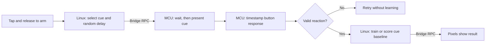

# QC UNO Q Workshop 205: Reflex Lab

As part of this workshop, attendees will turn the `101-Haptic Dial` hardware into a personal reaction-time experiment that learns separate baselines for light and vibration cues.

The app interacts in the following manner:

- The MCU presents each cue and measures the time until the knob button is pressed.
- Attendees record five valid light reactions and five valid vibration reactions.
- The Linux MPU learns the typical response and variation for each cue locally.
- New rounds are scored against the attendee's baseline as faster, typical, or slower.

All training and inference are local and do not depend on internet connectivity! Turning the knob is not part of this workshop.

> [!IMPORTANT]
> This is a `20x`-level workshop. Attendees should already be comfortable running an App Lab project and understand the MCU, MPU, and Bridge roles introduced in `101`.
>
> Complete the software prerequisites before arriving. Downloading App Lab or board software during the session will cause delays and may prevent you from keeping up with the build.

## Session Prerequisites

1. Complete or review [`101: Haptic Dial`](../101-haptic-dial/).
2. Install [Arduino App Lab](https://www.arduino.cc/en/software/#app-lab-section).
3. Clone this repository using `git clone https://github.com/aaishikasb/uno-q-workshops.git` in your terminal.

The baseline idea will be familiar if you have completed [`202: Anomaly Dial`](../202-anomaly-dial/), but it is not required.

## Hardware Setup (Provided On-site)

### Required Hardware

- Arduino UNO Q
- Modulino Knob
- Modulino Pixels
- Modulino Vibro
- 3 Qwiic cables
- USB-C cable

### Wiring

Chain the Modulinos with Qwiic:

```text
UNO Q Qwiic -> Modulino Knob -> Modulino Pixels -> Modulino Vibro
```

The order is not important for I2C, but using the same order makes debugging easier.

After connecting all Modulinos, connect the UNO Q to your computer with USB-C. Rest a finger on the Vibro so you can feel its cue, keep the Pixels visible, and use your other hand for the knob button. Keep this arrangement consistent between training and testing. Release the button before starting the app.

## App Lab Setup

1. Open Arduino App Lab.
2. Select your UNO Q board.
3. If the `Updates` modal appears, **DO NOT** update the board firmware during the workshop.
4. Open **My Apps**.
5. Import `workshop-app.zip` from this directory.
6. Open the imported `UNO Q Reflex Lab` app.
7. Confirm these files are present:
   - `app.yaml`
   - `python/main.py`
   - `python/button.py`
   - `python/reflex_model.py`
   - `sketch/sketch.ino`
   - `sketch/sketch.yaml`
8. Click `Run` in the top-right corner.
9. Keep the App Lab output panel visible. It tells you which cue to expect and reports accepted, false-start, and timeout results.

App Lab compiles and flashes the MCU sketch, then starts the Python runtime on the UNO Q Linux side. The Vibro pulses once during startup; this is not a trial cue. No additional Python packages or model downloads are required beyond the App Lab runtime.

## Train Your Reaction Baseline

The first run collects five valid responses to each cue in this order:

1. `light`: press when all eight Pixels turn white.
2. `vibration`: press when you feel the short Vibro pulse. The single amber waiting Pixel stays unchanged during this cue.

For every example:

1. Read the requested cue in the output.
2. Tap and release the knob to arm the trial. This start tap lasts 0.08–0.6 seconds and is not a measured reaction.
3. When one amber Pixel is lit, wait without pressing. The cue arrives after a random delay of 1.5–3.5 seconds.
4. Press as soon as you notice the cue, then release. The measured response ends on the press, not the release.
5. Read the response time and wait for the next ready prompt before starting another round.

Pressing before the cue is a false start. Responses under 100 ms are rejected as anticipations; no response within two seconds is a timeout. Rejected trials do not advance training or change the model. Keep responding naturally rather than deliberately slowing down to alter the baseline.

| Color or pattern | Meaning |
| --- | --- |
| Pink Pixels | Collecting light reactions |
| Purple Pixels | Collecting vibration reactions |
| One amber Pixel | Armed and waiting; do not press yet |
| Eight white Pixels | Light cue: press now |
| One amber Pixel plus a 120 ms vibration | Vibration cue: press now |
| Eight green Pixels during training | Valid example accepted |
| Three amber Pixels after a trial | False start, anticipation, or timeout; read the output |
| Blue Pixels | Trained baseline ready for a challenge |
| All Pixels off after a reset | Baseline cleared; release to return to training |
| Red Pixels | Saved baseline could not be erased; check the output |

The number of training Pixels shows progress for the current cue, with at least one Pixel lit. The output gives the exact example number. Results remain visible for at least one second after they are displayed and until the button is released. A start tap must begin after the next ready prompt; a press begun during feedback cannot arm the next round.

## Use The Trained Reflex Lab

After the tenth valid reaction, the Linux application trains and saves the two baselines. Tap and release to start each new challenge. The app randomly selects a light or vibration cue and names it in the output before the waiting period.

- Green indicates a response within two learned scales of your mean: `typical`.
- Purple indicates a response more than two scales below your mean: `faster`.
- Amber indicates a response more than two scales above your mean: `slower`.
- More lit Pixels indicate a larger absolute deviation, reaching eight at four scales.

Watch the output for the cue, reaction time in milliseconds, category, and signed deviation. Negative scores mean faster than the baseline; positive scores mean slower. The score is not a probability or a population ranking. Errors and slower responses both use amber, so read the output to distinguish them.

Challenge rounds do not update the saved baseline. Hold the knob down for three seconds at any time to erase it and retrain. The Pixels go dark; release and wait for the training prompt before starting a new round. An active trial is cancelled when the reset is detected, and the reset takes priority over any other taps delivered in the same batch.

## How The Demo Works



### MCU Responsibilities

- Sample the pushbutton at a target interval of 5 ms and debounce changes for 20 ms.
- Run the waiting period, issue the cue, and time the response on the same MCU clock.
- Timestamp an accepted press at the beginning of its stable transition.
- Detect false starts and timeouts even while Linux is waiting on a Bridge call.
- Keep vibration trials free of a simultaneous visual cue.
- Buffer button events for the app's start and reset controls and expose safe Bridge callbacks.
- Allow pending release transitions to finish debouncing before deciding that a hold reached three seconds.

### Linux MPU Responsibilities

- Choose the cue and random waiting duration, then request a trial.
- Collect five valid responses per cue and exclude retries from training.
- Learn separate means and variation scales for light and vibration.
- Score challenge rounds against the fixed baseline.
- Save the model to `data/reflex_model.json` using an atomic file replacement.

## The Model

This workshop uses a statistical model implemented with the Python standard library. For each cue, training calculates the mean reaction time and population standard deviation. A minimum scale of 40 ms prevents nearly identical training examples from making the model oversensitive.

```text
scale = max(training standard deviation, 40 milliseconds)
signed deviation = (new reaction time - training mean) / scale
```

A score below `-2` is faster, above `2` is slower, and between those bounds, including the boundaries, is typical. This is a comparison with one participant's examples, not a claim about whether a reaction is good or bad.

The complete learning loop is:

```text
present cue -> collect valid response -> learn baseline -> score fresh trials -> retrain
```

The MCU measures from completion of the cue command to the detected button transition, so Bridge round-trip time is not included. Sensor polling, I2C calls, LED updates, and motor startup still affect physical timing. This is a workshop experiment, not a calibrated reaction-time instrument. Five examples per cue make training short but produce a rough baseline; increase `EXAMPLES_PER_CUE` in `reflex_model.py` and retrain for a more stable estimate.

## Suggested Experiments

- Compare the learned light and vibration means, keeping your hand positions consistent.
- Run ten fresh challenges and count typical, faster, slower, and invalid trials separately.
- Swap participants without retraining, then retrain and compare the results.
- Deliberately anticipate the cue and verify that false starts do not enter the dataset.
- Retrain after practice and compare the old and new means printed in the output.
- Change `MINIMUM_SCALE_MS` in `reflex_model.py`, reset and retrain, then compare how often ordinary responses are flagged.

## Troubleshooting

### My trial reports a false start

Release the start tap fully. Wait through the single amber Pixel and press only when all eight Pixels turn white or you feel the vibration cue. The result output explains which condition failed.

### Vibration trials time out

Keep a finger resting on the Vibro and respond with your other hand. Check that the startup pulse can be felt. The waiting Pixel intentionally does not change when the vibration cue occurs.

### Ordinary responses are marked faster or slower

The result is relative to your own small training set. Keep your posture and hand positions consistent, collect representative responses, and retrain. The 40 ms minimum scale is adjustable in `reflex_model.py`.

### The app skips training when restarted

The baseline is intentionally persistent. Hold for three seconds to erase it. If saving fails, the active baseline remains in memory, but a restart may restore an older model or require training again.

### The output reports a button buffer overflow

The trial is cancelled. Release the button, then tap to arm another trial. Repeated overflows or malformed packets require restarting the app and checking board communication.

## Files

- `workshop-app/`: App Lab project source
- `workshop-app/python/main.py`: training and challenge flow
- `workshop-app/python/button.py`: MCU event parsing and reset-hold detection
- `workshop-app/python/reflex_model.py`: cue baselines, scoring, and persistence
- `workshop-app/sketch/sketch.ino`: cue scheduling, response timing, and hardware feedback
- `workshop-app.zip`: importable App Lab project
- `test_reflex_lab.py`: regression check with simulated trial results and Bridge calls
- `test_sketch.py`: host simulation of the actual sketch, including cue timing, false starts, timeouts, and clock rollover

Run from the repository root:

```sh
python3 -B 205-reflex-lab/test_reflex_lab.py
```

Software checks passed on 2026-10-30: model validation and persistence, training/challenge/reset flows, delayed input and feedback, and host simulations of cue timing, false starts, timeout boundaries, debounce, and MCU clock rollover. The command above also runs the host sketch simulation when a C++17 compiler (`c++`) is available; otherwise it reports that portion as skipped. It creates and removes its temporary build files automatically.

App Lab import, board compilation, I2C communication, and physical cue timing still need an on-device check. The host simulation does not compile against the Arduino board libraries.

## Sources

- Arduino UNO Q hardware docs: https://docs.arduino.cc/hardware/uno-q
- Arduino App Lab docs: https://docs.arduino.cc/software/app-lab/
- Arduino Bridge guide: https://docs.arduino.cc/software/app-lab/bridge/get-started-with-bridge
- Arduino Bridge API: https://docs.arduino.cc/software/app-lab/bridge/bridge-api
- Arduino RouterBridge library: https://github.com/arduino-libraries/Arduino_RouterBridge
- Arduino App structure: https://docs.arduino.cc/software/app-lab/apps/about-apps
- Arduino Modulino library: https://docs.arduino.cc/libraries/arduino_modulino
- Pinned Modulino 0.8.0 API source: https://github.com/arduino-libraries/Arduino_Modulino/blob/0.8.0/src/Modulino.h
